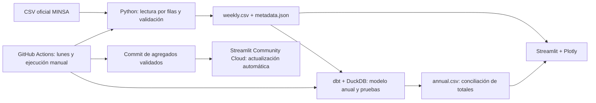

# DengueVisor

### Datos abiertos de dengue en Perú, convertidos en un explorador reproducible

**Periodo analizado:** 2020–2025 · **Fuente:** MINSA / CDC Perú · **Tecnologías:** Python, dbt, DuckDB, Streamlit y GitHub Actions

[](https://github.com/Kiara1616/DengueVisor/actions/workflows/ci.yml)
[](https://www.datosabiertos.gob.pe/dataset/vigilancia-epidemiol%C3%B3gica-de-dengue)

DengueVisor convierte el CSV público de vigilancia epidemiológica del MINSA en un dashboard para analizar notificaciones por departamento, año, semana y clasificación diagnóstica. El pipeline lee la fuente por filas, registra exclusiones, produce agregados sin datos personales y valida un modelo anual con dbt. Es un proyecto individual de [Kiara1616](https://github.com/Kiara1616) para la actividad 01-U2 de Data Engineering.

## Acceso al dashboard

**[Abrir DengueVisor en Streamlit](https://denguevisor-peru.streamlit.app/)**. También puedes ejecutarlo [localmente](#instalación-local) con los agregados incluidos. La pantalla inicial muestra un snapshot histórico; el periodo seleccionado y la cobertura disponible acompañan a los indicadores.

[Código público](https://github.com/Kiara1616/DengueVisor) · [Validación automática](https://github.com/Kiara1616/DengueVisor/actions/workflows/ci.yml) · [Fuente y diccionario](#fuente-alcance-y-diccionario) · [Consigna](docs/CONSIGNA.md)

El artículo y el video de construcción se incorporarán cuando estén publicados. El código, las instrucciones y los resultados se pueden consultar sin esperar esas publicaciones.

> **Uso responsable:** son conteos históricos y provisionales de registros notificados. No equivalen a incidencia por habitante, diagnóstico individual ni predicción epidemiológica.

## Resultados reproducibles del snapshot

| Indicador | Resultado |
|---|---:|
| Filas leídas del CSV oficial | 1 065 274 |
| Notificaciones dentro del alcance 2020–2025 | 719 965 |
| Filas excluidas por año fuera del alcance | 345 309 |
| Filas agregadas para el dashboard | 6 573 |

Los valores corresponden al snapshot procesado el **24 de noviembre de 2026**; el archivo fuente utilizado llega a 2025. La fecha de procesamiento no indica que el MINSA haya actualizado los datos ese día. Puedes comprobar los números en [`data/processed/metadata.json`](data/processed/metadata.json), reconstruirlos con `pipeline.py` y verificar su conciliación con `export_models.py`.

## Problema y propuesta

El MINSA publica un archivo voluminoso de vigilancia epidemiológica. DengueVisor facilita su consulta por año, semana, departamento y clasificación. La solución comprende ingesta, validación, transformación SQL con dbt, pruebas y trazabilidad. La actualización programada está configurada en GitHub Actions; su operación pública se verifica en la pestaña Actions.

## Funciones

- Modo claro y oscuro; encabezado verde azulado, tarjetas con contexto, pestañas y gráficos interactivos.
- Búsqueda y selección de hasta cinco departamentos.
- Filtros combinables por años, semanas y diagnósticos C/P/S.
- Tendencias semanales, composición diagnóstica y comparación territorial.
- Ranking nacional que respeta periodo y diagnósticos, con su alcance indicado.
- CSV filtrado y resumen anual construido por dbt.
- Metadatos con recuento de filas, exclusiones, fecha de procesamiento y SHA-256 del agregado.

## Arquitectura



El procesamiento ocurre fuera del servidor del dashboard. Este consume archivos pequeños versionados, sin descargar el CSV original en cada visita. La solución usa GitHub y Streamlit Community Cloud para automatización y publicación; no requiere servicios AWS.

## Fuente, alcance y diccionario

Fuente: [Vigilancia Epidemiológica de dengue — MINSA / CDC Perú](https://www.datosabiertos.gob.pe/dataset/vigilancia-epidemiol%C3%B3gica-de-dengue).

[Recurso CSV utilizado](https://www.datosabiertos.gob.pe/sites/default/files/datos_abiertos_vigilancia_dengue_2000_2025_0.csv). El enlace puede cambiar: en ese caso se debe actualizar `SOURCE` en `pipeline.py`, revisando la ficha oficial.

| Salida | Campo de origen | Interpretación |
|---|---|---|
| `year` | `ano` | Año de notificación definido por la fuente; alcance 2020–2025 |
| `week` | `semana` | Semana epidemiológica; valores admitidos 1–53 |
| `department` | `departamento` | Departamento normalizado con mayúsculas y sin espacios laterales |
| `diagnosis` | `tipo_dx` | C: confirmado; P: probable; S: sospechoso |
| `notifications` | Conteo de filas | Registros por combinación de las cuatro dimensiones |

No se eliminan filas iguales automáticamente: sin un identificador de caso, registros con los mismos atributos pueden representar personas diferentes. El proceso agrega registros, no identifica personas. Se descartan del producto campos individuales no necesarios.

El archivo publicado por MINSA cubre hasta 2025: ejecutar el pipeline en 2026 no incorpora datos de 2026. El tablero declara el periodo de análisis y la fecha de procesamiento por separado. La fuente puede revisar semanas anteriores.

## Instalación local

Python **3.12** y Git. Desde PowerShell, con espacio disponible en la unidad elegida:

```powershell
git clone https://github.com/Kiara1616/DengueVisor.git
cd DengueVisor
python -m venv .venv
.\.venv\Scripts\python.exe -m pip install -r requirements-dev.txt
.\.venv\Scripts\python.exe -m streamlit run app.py
```

Los agregados incluidos permiten abrir la app sin una descarga inicial. Accede a `http://localhost:8501`. Para instalar únicamente el dashboard, usa `requirements.txt`; las herramientas de pruebas y dbt están en `requirements-dev.txt`.

### Reconstruir todo desde la fuente

Ejecuta desde la raíz del repositorio:

```powershell
.\.venv\Scripts\python.exe pipeline.py
.\.venv\Scripts\dbt.exe build --profiles-dir .
.\.venv\Scripts\python.exe export_models.py
.\.venv\Scripts\python.exe -m pytest -q
```

En Linux/macOS usa `.venv/bin/python` y `.venv/bin/dbt`. Para reproducir una copia local del CSV: `python pipeline.py --input ruta/al/archivo.csv`. El proceso remoto lee por filas y no guarda el CSV completo en disco.

### Trabajar en D: si C: está lleno

```powershell
New-Item -ItemType Directory -Force D:\Codex\temp
$env:TEMP = 'D:\Codex\temp'
$env:TMP = $env:TEMP
cd D:\Codex\DengueVisor
```

Estas variables afectan solo esa terminal. Crea también el entorno virtual en D:.

## Calidad y reproducibilidad

Las pruebas cubren agregación, columnas requeridas, exclusiones, preservación de la publicación previa ante fuentes vacías y carga del dashboard en ambos temas. dbt comprueba columnas obligatorias, diagnósticos permitidos y conteos positivos. La exportación anual verifica que su total coincida con el agregado semanal.

El pipeline rechaza una fuente sin columnas requeridas o sin filas válidas. Registra exclusiones con una única razón por fila; debe cumplirse `source_rows = notifications_in_scope + excluded_rows`. Los agregados se preparan antes de sustituir el CSV publicado. Si el workflow falla antes del commit, el repositorio y la app pública conservan la versión anterior.

Las dependencias directas verificadas están fijadas en `requirements.txt` y `requirements-dev.txt`; los CSV y su huella permiten verificar el snapshot publicado, aunque el MINSA revise el original.

## CI, actualización y despliegue automático

| Flujo | Activación | Resultado |
|---|---|---|
| `ci.yml` | Push, pull request o manual | pytest, `dbt build` y conciliación/exportación |
| `update-data.yml` | Lunes 12:17 UTC (07:17 Perú) o manual | Descarga, transformación, pruebas y commit de agregados |
| Streamlit Community Cloud | Cambios en la rama conectada, tras conexión inicial | Actualiza la app pública desde GitHub |

Los commits con `GITHUB_TOKEN` no disparan necesariamente otro workflow de Actions. El flujo de datos ya ejecuta sus propias validaciones antes del commit. El despliegue de Community Cloud observa el repositorio directamente. Las actualizaciones de código publicadas en la rama conectada no están bloqueadas por el resultado de CI: revisa la ejecución antes de integrar cambios.

## Publicar sin AWS: pasos

1. Publica este repositorio como **público** en `Kiara1616/DengueVisor`.
2. Revisa la pestaña **Actions** y ejecuta **Calidad y modelos dbt**. Corrige cualquier error antes de continuar.
3. Entra en [Streamlit Community Cloud](https://share.streamlit.io/) con tu cuenta de GitHub. Autoriza el acceso al repositorio.
4. Selecciona **Create app / Deploy from GitHub**; repositorio `Kiara1616/DengueVisor`, rama `main`, archivo `app.py`.
5. En opciones avanzadas elige Python 3.12. Solicita un subdominio disponible, por ejemplo `denguevisor-peru`; no se presume que esté libre.
6. Despliega, espera a que termine e inspecciona logs si hay errores. Copia la URL pública real.
7. Prueba el enlace en incógnito: tema claro/oscuro, búsqueda, filtros y descarga CSV.
8. Para demostrar automatización, cambia un texto del dashboard en GitHub y comprueba que se refleja en la app sin una publicación manual adicional.
9. En **Actions → Actualizar datos MINSA → Run workflow**, ejecuta una actualización. Si la política de tu cuenta lo permite, `contents: write` autoriza el commit. Las reglas de protección pueden requerir ajustar el flujo a pull requests.
10. Guarda capturas de CI, actualización y app; serán evidencias para el artículo y el video.

[Guía oficial de despliegue](https://docs.streamlit.io/deploy/streamlit-community-cloud/deploy-your-app/deploy) · [Actualización automática desde GitHub](https://docs.streamlit.io/deploy/streamlit-community-cloud/manage-your-app/edit-your-app).

## Consigna y entregables

La actividad pide una solución Data Engineering con herramientas como Airflow, Kafka, Luigi, Fabric o dbt, evitando AWS; repositorio público, despliegue automatizado, app en nube/SaaS, artículo y video público de hasta cinco minutos. También pide enviar artículo y video a Telegram y subir los enlaces en ZIP.

| Requisito | Evidencia que corresponde entregar |
|---|---|
| Herramienta Data Engineering | Modelos SQL y pruebas dbt sobre DuckDB; logs de `dbt build` |
| Repositorio público | URL de este repositorio y README |
| Automatización | Ejecuciones GitHub Actions y prueba de actualización de Community Cloud |
| Nube/SaaS público | URL real de la app en `streamlit.app` |
| Artículo individual | Publicación en Medium, Dev.to o Hashnode; borrador en `ARTICLE_DRAFT.md` |
| Video ≤ 5 minutos | URL pública y duración; guion en `VIDEO_SCRIPT.md` |
| Telegram y ZIP | Envío manual a tu grupo y ZIP con enlaces finales |

La existencia del código o de un borrador no acredita publicaciones. Revisa `docs/ENTREGA.md` y completa `LINKS_TEMPLATE.txt` únicamente con URLs verificadas.

## Estructura

```text
app.py                    # UI y gráficos
pipeline.py               # Ingesta remota/local y validación
export_models.py          # Conciliación y exportación dbt
models/                   # Modelo anual y pruebas de esquema
tests/                    # Pruebas Python y SQL
data/processed/            # Snapshot agregado y metadatos
.github/workflows/        # Calidad y actualización
.streamlit/config.toml    # Tema base y configuración
docs/ENTREGA.md            # Lista final de evidencias
```

## Límites de interpretación

Son conteos de registros notificados, no personas deduplicadas ni tasas por habitantes. No permiten concluir riesgo individual ni causalidad. Las semanas sin registros no se rellenan con cero. No se comparan periodos incompletos como si fueran años completos. Los estados de diagnóstico se muestran separados y pueden filtrarse.

## Autoría y uso de los datos

Desarrollo individual: [Kiara1616](https://github.com/Kiara1616). Fuente y titularidad de los datos: MINSA / CDC Perú. La ficha oficial declara **Open Data Commons Attribution License**; conserva la atribución al reutilizar los agregados. Este repositorio no representa un servicio oficial ni modifica la licencia de la fuente.
